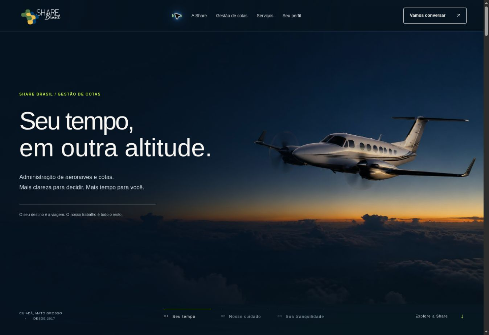
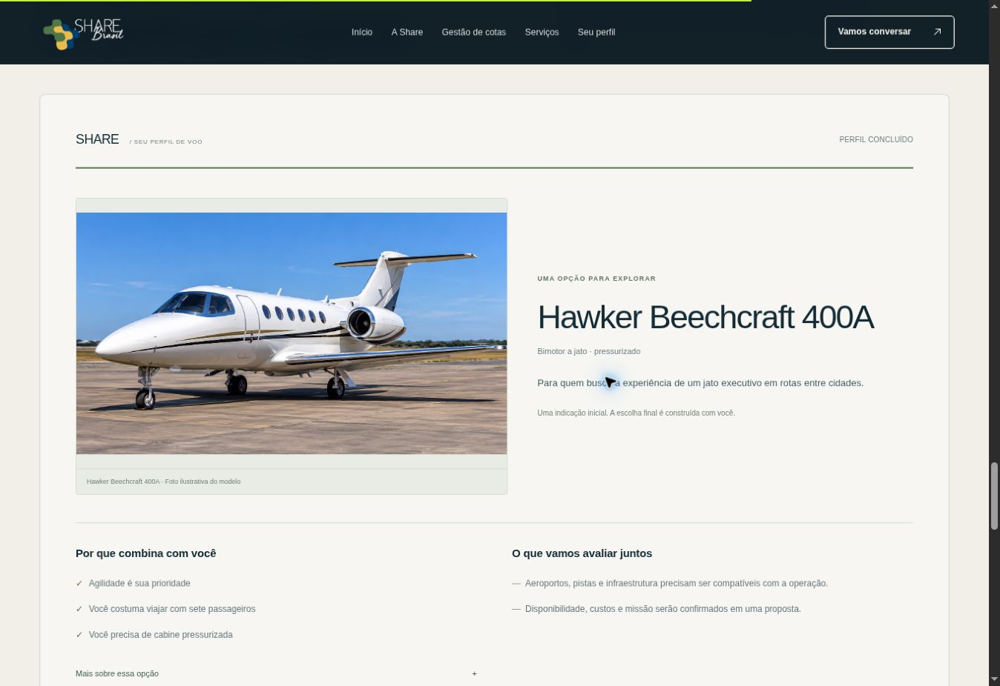
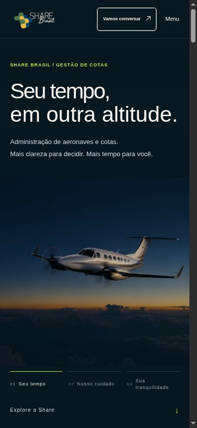

# Experiência institucional Share Brasil

A revisão parte da branch principal no commit `789acac` e mantém a comunicação centrada em gestão de cotas e administração de aeronaves.

## O que mudou

- A imagem existente permanece fixa somente na abertura, enquanto três mensagens se alternam na rolagem natural. Os controles permitem escolher uma mensagem ou seguir diretamente para o conteúdo; não há interceptação de roda, toque ou teclado.
- A composição preserva a aeronave inteira em computador e em viewport móvel de 390 px.
- Azul profundo, petróleo e marfim organizam as seções. O verde Share destaca ações principais e seleções; ações secundárias têm menos peso.
- Menu móvel com estado de expansão, fechamento por link e Escape. O teclado retorna ao botão Menu quando fecha por Escape.
- A leitura institucional fica estável; foram retirados os efeitos de deslocamento de todos os capítulos e a rotação decorativa contínua.
- O portal e o simulador continuam funcionais em uma demonstração expansível opcional. Os resumos para impressão ficam fora do elemento fechado para continuar disponíveis.
- O quiz tem alternativas visuais, resumo das preferências atualizado a cada escolha e resultado com foto, motivos e uma alternativa para comparar. Não antecipa o modelo recomendado.
- Contato e autorização seguem opcionais, sem persistência de dados pessoais no navegador. Pesos, filtros, sete modelos, endpoints, eventos e contrato v3 são preservados. Não exige migração D1 ou mudança do backend.

## Verificação

32 testes aprovados, incluindo enumeração das regras do quiz, captura opcional, resumo sem recomendação antecipada, conteúdo acessível com redução de movimento e navegação por teclado. TypeScript e build de produção aprovados.

No navegador foram verificados: troca das mensagens com a cena fixa, menu móvel, largura sem transbordamento horizontal em 390 px, início sem contato, escolhas até o resultado Hawker 400A com a foto do R2, serviços e abertura do simulador. A verificação da interface não substitui o teste da gravação no D1 publicado.

A prévia usou uma configuração local de teste, removida antes do build. O build final mantém `https://api.share-brasil.com` como API padrão e não inclui arquivos auxiliares de verificação.

## Prévias

