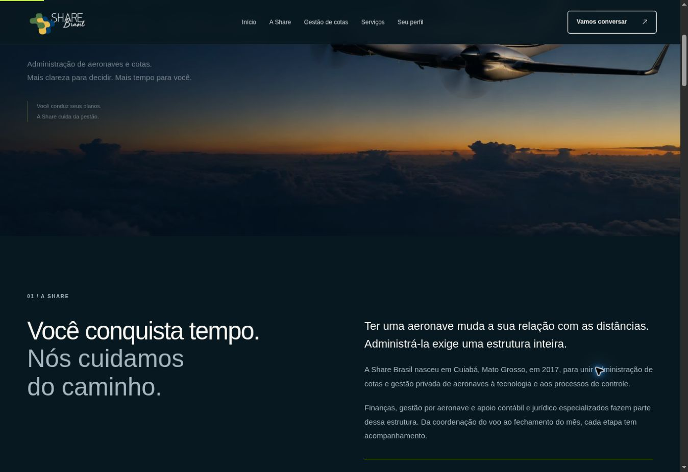
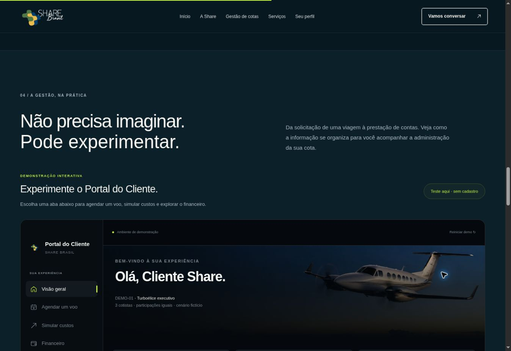
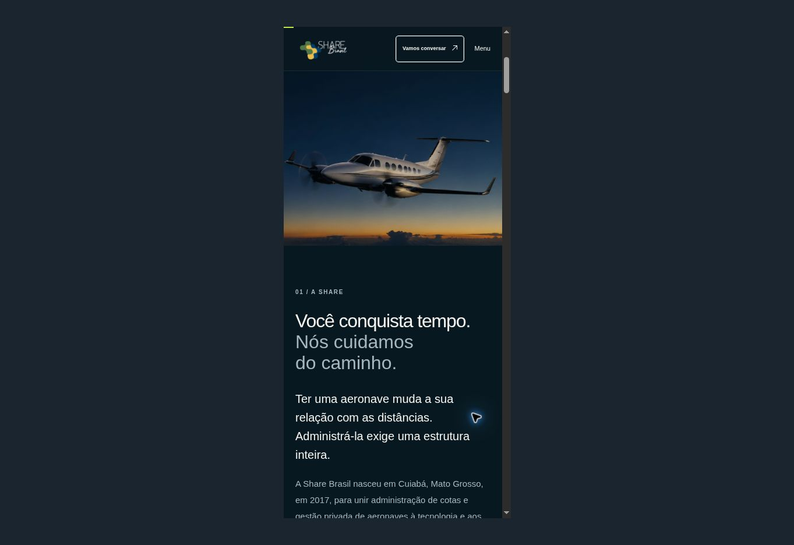
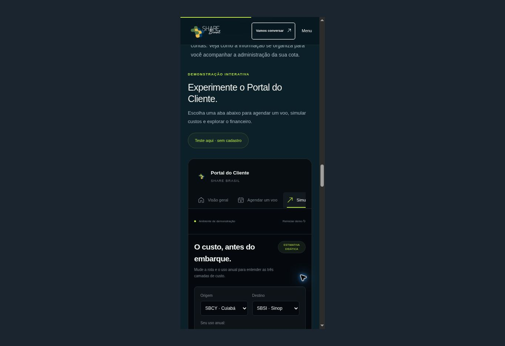

# Hero com saída direta para A Share

A abertura usa uma única tela com `public/assets/hero-aircraft.jpg`. Não há cenas intermediárias, plano marfim, capítulos internos ou área vazia para prolongar a rolagem. A seção A Share é o próximo elemento no fluxo e sobe enquanto a foto e o texto de abertura saem, com deslocamento e opacidade leves controlados pela rolagem.

## Implementação

- `src/site/story-motion.ts`: função pura para deslocamento, zoom e opacidade, com retorno exato ao voltar na rolagem.
- `src/site/cinema.ts`: calcula o progresso pela posição/altura real do hero e mantém o menu acessível. Sem controle de cenas nem observadores de capítulos.
- `src/styles/cinema.css`: hero de `100svh`, sem sticky ou altura de múltiplas telas; o conteúdo da primeira seção tem fundo contínuo em toda a largura.
- Movimento reduzido: fotografia, texto e fluxo permanecem visíveis, sem transformações ou fade. Não há captura de roda, toque ou teclado.

## Portal visível

A seção 04 contém a demonstração renderizada diretamente, sem `details`, `summary` ou ação para expandir. O cabeçalho informa “DEMONSTRAÇÃO INTERATIVA” e “Teste aqui · sem cadastro”. As abas de agenda, simulação, financeiro e manutenção estão disponíveis de imediato. O link que leva ao simulador apenas seleciona essa aba.

Os dados seguem fictícios; as solicitações da demo não são enviadas. Quiz escuro, sete modelos, contato opcional e contrato D1 preservados.

## Validação

Testes de progresso em 30%, avanço a 60% e retorno; abertura única seguida diretamente pela seção A Share; movimento reduzido; portal visível sem expansão; simulação acessível; limpeza e remontagem em StrictMode. TypeScript, lint e build de produção.

Conferência no navegador: desktop de 936 px de altura com hero de 936 px e início de A Share exatamente em 936 px. Após rolar 468 px, o conteúdo já estava em 468 px, junto à saída da imagem. No viewport móvel de 390 px, o hero e o início de A Share mediram 844 px; a página permaneceu sem transbordamento horizontal (375 px úteis com barra de rolagem). O portal não tem ancestral oculto e a simulação funcionou no desktop e no celular.

38 testes aprovados, TypeScript, lint dos arquivos alterados e build de produção concluídos.

Nenhum lead foi gravado no D1 de produção nesta revisão.
