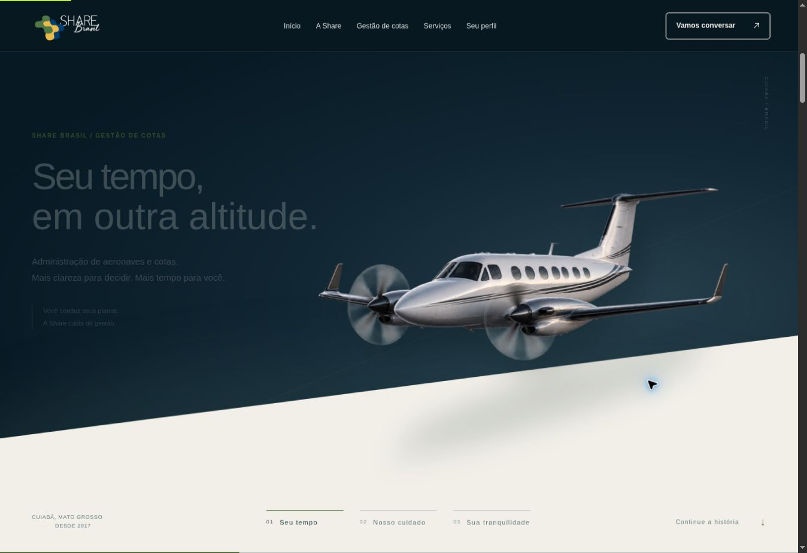
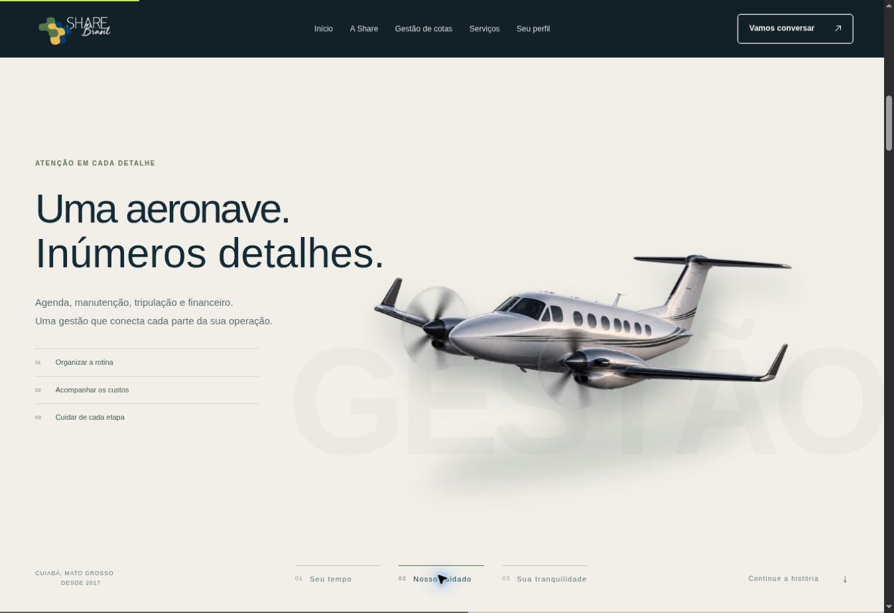
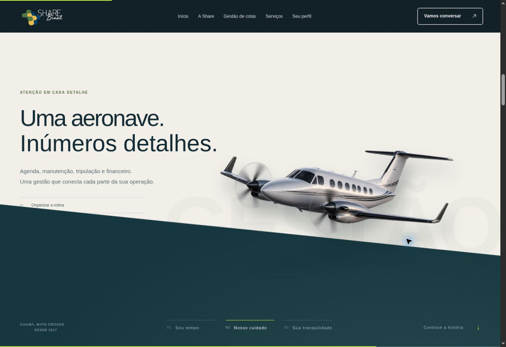
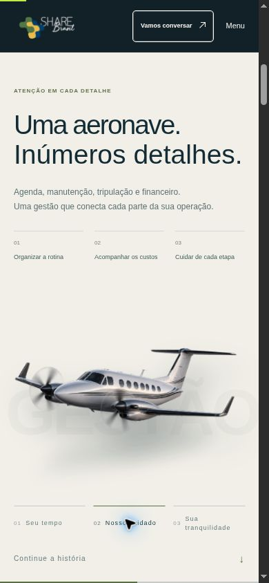

# Scrollytelling da Share Brasil

A abertura usa três cenários de tela inteira, com a aeronave em primeiro plano e dois planos diagonais independentes entrando por trás. A rolagem é a linha do tempo: não há reprodução automática ou atraso de suavização da pose. Os controles de capítulo apenas rolam a página até posições definidas.

## Implementação

- `src/lib/story-motion.ts` transforma o progresso entre 0 e 1 em posições, escalas, inclinações, rotações e cortes. A mesma entrada sempre produz os mesmos valores, na ida e na volta.
- `public/scrollytelling.css` aplica as variáveis à aeronave, ao fundo e aos planos marfim e petróleo. As camadas da abertura não têm transições baseadas em tempo.
- O avião é um render ilustrativo transparente com aparência tridimensional. A profundidade e a trajetória usam perspectiva CSS sobre a imagem; não há malha volumétrica WebGL/GLB ou câmera livre. O recorte permanece visível entre os cenários.
- A área fixa usa `overflow: clip`, evitando que foco/clique nos controles role o conteúdo interno da cena. O documento continua com rolagem natural, sem interceptar roda, toque ou teclado.
- Com redução de movimento, as cenas aparecem em fluxo normal e todo o conteúdo permanece acessível. A ilustração fica estática. A impressão usa o mesmo princípio.
- O restante do site, quiz, regras comerciais das sete aeronaves, captura opcional e integração D1 permanecem como na versão anterior.

## Verificação

36 testes aprovados, TypeScript e build de produção. Os testes incluem posições intermediárias em 30%, continuidade entre trechos, avanço para 60% e retorno exato à pose anterior, redução de movimento e navegação por teclado.

No navegador, a rolagem natural atingiu `0.2999`: o plano marfim estava em `64.08198757763975%` e a inclinação do avião em `-9.62361827560796deg`. Após avançar e voltar, os dois valores retornaram exatamente ao mesmo estado. O plano fixo manteve `scrollTop = 0` ao navegar pelos controles. Foram conferidas as cenas completas e os cortes intermediários, além do viewport móvel de 390 px sem transbordamento horizontal. Não foi feito novo teste de gravação no D1 publicado.

## Prévias

## Origem da ilustração

Arquivo: `public/assets/aircraft-cinema.png`, PNG com alpha, 1774 × 887 pixels, 919.896 bytes. Criado com a ferramenta integrada de geração de imagem, usando `public/assets/hero-aircraft.jpg` como referência. É uma ilustração, sem matrícula ou identificação de um exemplar da frota. O original da geração foi mantido; a cópia no projeto é usada pelo site.

Prompt de produção:

> Use case: style-transfer / background-extraction. Asset type: foreground aircraft for a premium aviation company scroll-driven website. Edit target: the twin turboprop executive aircraft visible in the supplied photograph. Create ONE isolated aircraft as a photorealistic high-end 3D product render, three-quarter front side view, nose pointing LEFT and slightly toward the viewer, tail on the right, same sleek silver-white twin turboprop / T-tail silhouette as the reference. Keep both wings, both engines, propellers and entire tail completely inside the frame, generous transparent margin all around. Landing gear retracted, in-flight configuration. Clean neutral studio lighting with soft cool reflections, realistic glossy white aluminum and subtle dark trim; sufficient soft highlights so the aircraft is readable over both deep navy and warm ivory website scenes. The whole aircraft should occupy around 85% of a wide landscape canvas. Remove ALL clouds, sky, horizon, background, ground and scenery. Truly transparent alpha background, including between the wings and propellers. No text, no letters, no logo, no registration, no pedestal, no border, no cast ground shadow. A single complete premium aircraft asset, no montage and no cropped wings. This is an illustrative website aircraft, not a diagram or an exact certified model.
