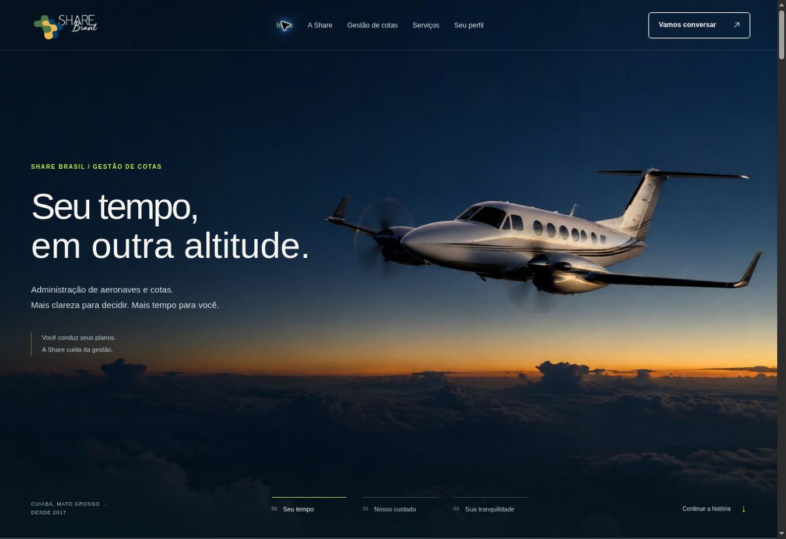
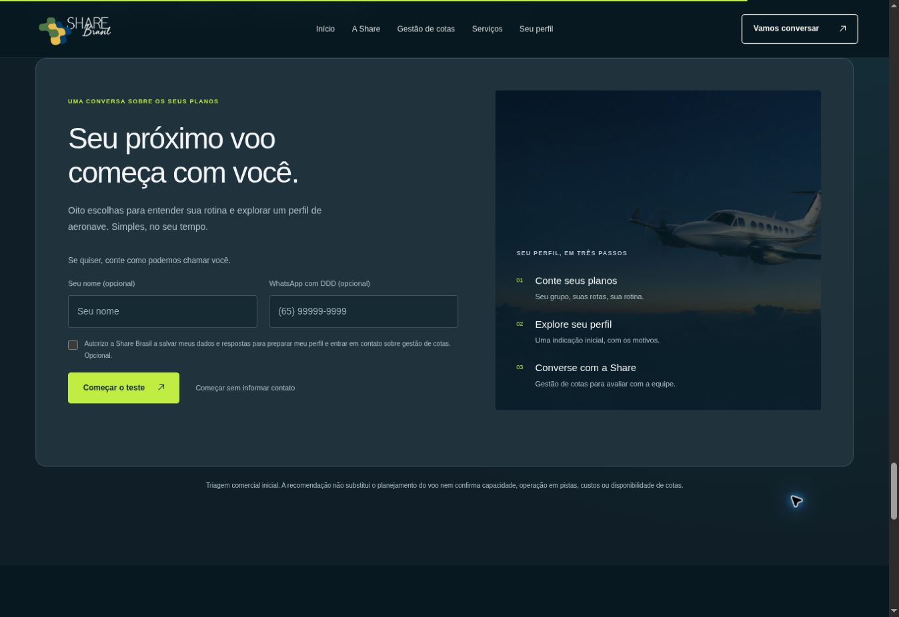
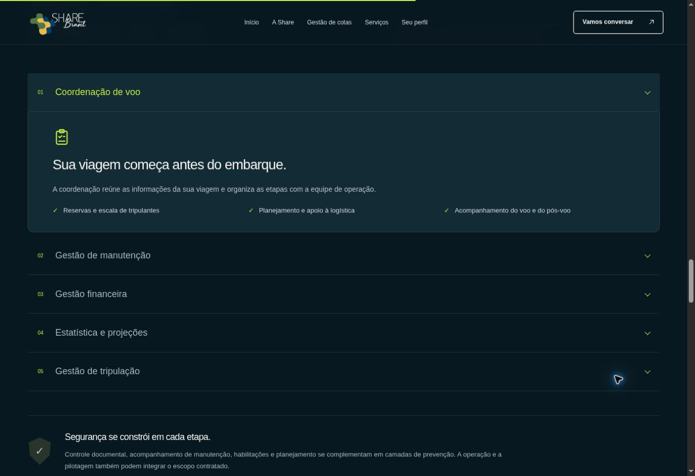
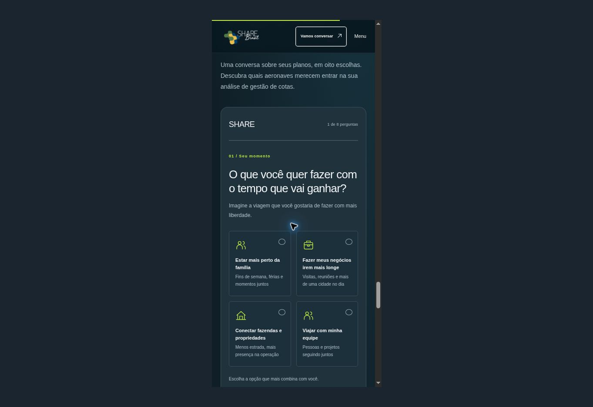

# Apresentação com o céu original

O hero preserva `public/assets/hero-aircraft.jpg` inteira: céu, aeronave e pôr do sol formam uma única cena. O render recortado foi removido. O enquadramento muda suavemente, enquanto os capítulos de gestão entram com corte diagonal e leve inclinação. Nas telas menores, o texto ocupa a parte superior e a fotografia permanece na região inferior.

## Organização e ciclo de vida

A rota `src/routes/index.tsx` importa os estilos e chama `iniciarSite`, `iniciarCinema` e `iniciarQuiz` no efeito React. Cada inicializador devolve sua limpeza. Não há injeção de scripts nem guardas globais como `window.__cinema`.

- `src/site/cinema.ts`: menu acessível, atualização via requestAnimationFrame e controles que rolam até pontos da cena.
- `src/site/story-motion.ts`: função pura entre 0 e 1 para zoom da foto, deslocamento, inclinação e entrada dos planos. O mesmo progresso produz os mesmos valores, inclusive ao voltar.
- `src/styles/cinema.css`: fotografia e capítulos. Sem transições temporais nas camadas; `overflow: clip` impede deslocamento interno ao focar os controles.
- `src/site/interactions.js`: composição da página, contato e progresso de leitura; `services.js`: abas dos serviços; `events.js`: eventos e animações com limpeza.
- `src/portal/portal.js`: interface da demonstração, cancelamento de timers, liberação de URLs de download e remoção dos elementos temporários de impressão.
- `src/quiz/`: quiz montado diretamente, sem eventos globais; sete modelos e contrato D1 preservados. A aparência escura está em `src/styles/quiz.css`.

Foram removidos o observador da antiga barra de capítulos, os estilos antigos do hero e da ilustração circular de cotas e as classes de revelação sem uso. O ícone da coordenação é uma prancheta SVG local.

## Acessibilidade

A rolagem é nativa: não há captura de roda, toque ou teclado. Com redução de movimento, os três conteúdos ficam em fluxo normal e a fotografia é estática. Os formulários e tabelas não recebem animações de rolagem. Contato, consentimento e início sem identificação continuam opcionais.

## Validação

Testes do progresso em 30%, avanço a 60% e retorno exato; continuidade da linha do tempo; montagem, limpeza e remontagem em StrictMode; regras das sete aeronaves, envio opcional e contrato do Worker em SQLite. TypeScript e build de produção.

Verificação no navegador: desktop, menu móvel, formulário opcional, seleção de respostas e viewport de 390 px (375 px úteis com a barra de rolagem), sem transbordamento horizontal. O capítulo intermediário atingiu progresso `0.5300` e manteve `scrollTop = 0` no palco fixo.

Prévias atuais:

Não foi realizada gravação de um lead no D1 de produção nesta revisão.
